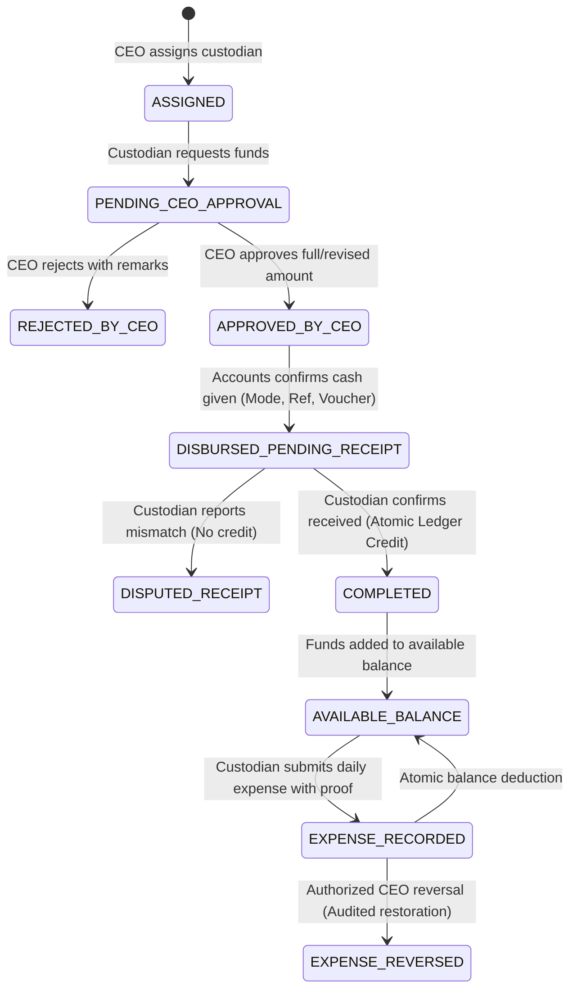
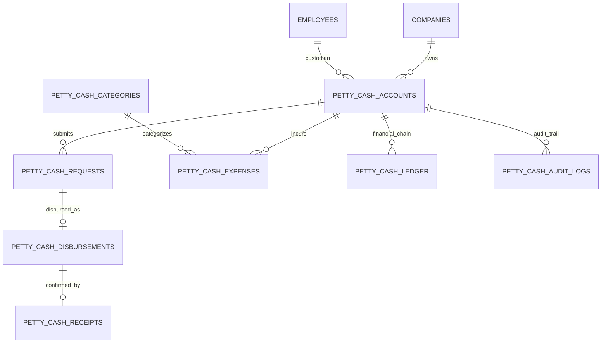

# BUSINZ Enterprise HRMS — Petty Cash Management Module Implementation Report

**Document Version:** 1.0.0  
**Status:** Completed & Validated in Development  
**Git Branch:** `feature/petty-cash-management`  
**Target Environment:** Hostinger VPS Cloud (Node.js/Express, PostgreSQL, React/Vite)  
**Date:** October 24, 2026  

---

## Executive Summary

A complete, production-grade **Petty Cash Management Module** has been designed, developed, and verified within the BUSINZ Enterprise HRMS platform. This module adheres strictly to company financial controls, role-based access control (RBAC), multi-tenant isolation, immutable ledger accounting (`NUMERIC(14,2)` precision with Decimal arithmetic), and the VRM Enterprise HRM Design System (`.agents/AGENTS.md`).

---

## 1. System Architecture & Workflow

### 1.1 Architecture Layering
```
[React/Vite Frontend]
       │
       ▼ (HTTPS / Bearer JWT)
[Express Route Layer: /api/v1/petty-cash]
       │
       ▼
[Authentication & RBAC Middleware]
       │ (CEO / Accounts / Custodian)
       ▼
[Zod Input Validation Schemas]
       │
       ▼
[Petty Cash Controller]
       │
       ▼
[Petty Cash Service] (Business Rules, Transitions & Audit Logging)
       │
       ▼
[Petty Cash Repository] (Mutex Locking, Atomic Balance Verification)
       │
       ▼
[PostgreSQL Database (or In-Memory Dev/Test Store with Decimal.js)]
```

### 1.2 Multi-Stage Lifecycle State Machine


---

## 2. PostgreSQL Database Schema & Relationships

### 2.1 Table Structure (Additive Migration: `backend/migrations/017_petty_cash_module.sql`)

| Table Name | Description | Key Constraints |
|:---|:---|:---|
| **`petty_cash_accounts`** | Master custodian account per company | Unique active account per company (`WHERE status = 'ACTIVE'`); low-balance threshold; balance columns |
| **`petty_cash_categories`** | Configurable expense categories | Tea & Coffee, Stationery, Courier, Local Transport, Petrol, Maintenance, Cleaning, etc. |
| **`petty_cash_requests`** | Custodian requisition records | Auto-numbering `PCREQ-YYYY-NNNN`, positive amount check, status machine |
| **`petty_cash_disbursements`**| Accounts cash disbursement records | Auto-numbering `PCDSB-YYYY-NNNN`, Payment Mode enum, reference voucher |
| **`petty_cash_receipts`** | Custodian confirmation records | Unique idempotency key, status enum (`CONFIRMED` / `DISPUTED`) |
| **`petty_cash_expenses`** | Daily operational expense entries | Auto-numbering `PCEXP-YYYY-NNNN`, category FK, proof URL, reversal flags |
| **`petty_cash_ledger`** | **Immutable Financial Source of Truth** | Auto-numbering `PCLED-YYYY-NNNN`, Credit/Debit `NUMERIC(14,2)`, Running balance |
| **`petty_cash_attachments`**| Secure proof & voucher file metadata | MIME type verification, file size checks, entity linkage |
| **`petty_cash_audit_logs`** | Complete regulatory audit trail | Performed by ID/Role, IP address, JSON action snapshot |

### 2.2 Entity Relationship Diagram


---

## 3. Backend Endpoints & API Specification

Mounted under: `/api/v1/petty-cash`

| Method | Endpoint | Authorized Roles | Purpose |
|:---|:---|:---|:---|
| **GET** | `/custodian/active` | Authenticated | Fetch active custodian account & current balance |
| **GET** | `/custodian/history` | CEO, Accounts | View custodian stewardship history |
| **POST** | `/custodian/assign` | **CEO Only** | Assign active employee as custodian |
| **POST** | `/custodian/reconcile` | **CEO Only** | Safe custodian handover with physical count & ledger reconciliation |
| **POST** | `/requests` | Custodian | Submit petty cash fund request (`PENDING_CEO_APPROVAL`) |
| **GET** | `/requests` | Authenticated | List fund requests (Scoped for regular staff, full for CEO/Accounts) |
| **POST** | `/requests/:id/approve` | **CEO Only** | Approve or reject fund request with remarks |
| **POST** | `/requests/:id/disburse` | **Accounts / Finance** | Confirm cash given with voucher/payment mode (`DISBURSED_PENDING_RECEIPT`) |
| **GET** | `/disbursements` | Accounts, CEO | List disbursements and pending employee receipt confirmations |
| **POST** | `/receipts/confirm` | Custodian | Confirm cash received (Atomic balance credit) or dispute mismatch |
| **POST** | `/expenses` | Custodian | Record daily expense with proof (Atomic debit; prevents negative balance) |
| **GET** | `/expenses` | Authenticated | Query daily expenses with category and date range filters |
| **POST** | `/expenses/:id/reverse` | **CEO Only** | Authorize audited expense reversal and credit funds back to balance |
| **POST** | `/expenses/:id/flag` | Accounts, CEO | Flag expense discrepancy for investigation without balance alteration |
| **GET** | `/categories` | Authenticated | List operational expense categories |
| **POST** | `/categories` | CEO, Accounts | Create customized expense category |
| **GET** | `/ledger` | Authenticated | Query immutable transaction ledger entries |
| **GET** | `/dashboard/summary` | Authenticated | Aggregated KPIs, balances, and low-balance warnings |
| **GET** | `/reports/ledger` | CEO, Accounts | Comprehensive financial ledger & category-wise reconciliation report |
| **POST** | `/attachments/upload` | Authenticated | Secure upload handler for JPG, PNG, and PDF receipts |

---

## 4. Role-Based Permission Matrix (RBAC)

| Action / Capability | CEO / Super Admin | Accounts / Finance | Assigned Custodian | Other Employees |
|:---|:---:|:---:|:---:|:---:|
| **Assign / Reassign Custodian** | ✅ (Exclusive) | ❌ | ❌ | ❌ |
| **Reconcile Physical Cash** | ✅ (Exclusive) | ❌ | ❌ | ❌ |
| **Request Petty Cash Funds** | ❌ (Operational) | ❌ | ✅ (Exclusive) | ❌ |
| **Approve / Reject Requests** | ✅ (Exclusive) | ❌ | ❌ | ❌ |
| **Disburse Cash & Record Mode**| ❌ | ✅ (Exclusive) | ❌ | ❌ |
| **Confirm Cash Receipt** | ❌ | ❌ | ✅ (Exclusive) | ❌ |
| **Report Cash Discrepancy** | ❌ | ❌ | ✅ (Exclusive) | ❌ |
| **Record Daily Expense** | ❌ | ❌ | ✅ (Exclusive) | ❌ |
| **Upload Bill Proof (JPG/PDF)**| ❌ | ✅ (Vouchers) | ✅ (Receipts) | ❌ |
| **Review & Flag Expenses** | ✅ | ✅ | ❌ | ❌ |
| **Authorize Reversal Credit** | ✅ (Exclusive) | ❌ | ❌ | ❌ |
| **View Immutable Ledger** | ✅ | ✅ | ✅ (Account Scope) | ❌ |
| **Export Excel / PDF / CSV** | ✅ | ✅ | ❌ | ❌ |
| **Access Module in Sidebar** | ✅ | ✅ | ✅ | ❌ (Hidden & Locked) |

---

## 5. Financial Source of Truth & Balance Safeguards

### 5.1 Authoritative Balance Formula
$$\text{Available Balance} = \sum \text{Confirmed Cash Credits} - \sum \text{Vouchered Expense Debits} + \sum \text{Authorized Reversals}$$

### 5.2 Prevention of Double-Spending & Negative Balances
1. **Decimal Precision**: All monetary operations execute using `NUMERIC(14,2)` and `Decimal.js` to eliminate JavaScript IEEE-754 floating-point inaccuracies.
2. **Atomic Mutex Locking**: During disbursement confirmation, expense deduction, and custodian reconciliation, the repository acquires an exclusive transactional mutex lock on the account record.
3. **Overdraft Rejection**: Any expense where $\text{amount} > \text{Available Balance}$ is immediately aborted with HTTP 400 (`Insufficient funds: Available balance is ₹X, requested ₹Y`).
4. **Idempotency Keys**: Both receipt confirmation and expense recording enforce client-supplied unique idempotency keys (`idempotency_key`), rendering duplicate network requests completely harmless.
5. **Reversal Audit**: Historical ledger debit records are never deleted or silently edited. Correction workflows generate a separate `EXPENSE_REVERSAL_CREDIT` transaction linking back to the original entry.

---

## 6. Frontend Architecture & Design System Adherence

Built strictly in conformance with the **VRM Enterprise HRM Design System** (`.agents/AGENTS.md`):

1. **Brand Palette**:
   - Primary Deep Teal: `#0E7490`
   - Primary Hover: `#0891B2`
   - Primary Light / Selection Accent: `#ECFEFF` with `4px solid #0E7490` active vertical border
   - Solar Orange Accent: `#F39C12`
   - Cards / Surface: `#FFFFFF` with 16px radius (`--radius-card`)
   - Text Hierarchy: `#1E293B` (Primary) and `#64748B` (Secondary)
2. **Standardized Interactive Table**:
   - Styled checkboxes with `accent-color: #0E7490`.
   - Floating Action Bar fixed at bottom center (`position: fixed; bottom: 24px; left: 50%; transform: translateX(-50%)`) for batch operations.
   - Standard Table Pagination footer strictly offering `[5, 10]` rows per page with active page highlighting in `#0E7490` and jump-to-page input.
3. **Responsive Mobile Ergonomics**:
   - Single-column responsive layouts for mobile screens (320px–390px).
   - Numeric keyboards invoked automatically on amount inputs (`inputMode="decimal"`).
   - Touch targets designed to $\ge 44\text{px}$.
   - Number spin buttons hidden across all browsers.
   - Date formats standardized to `DD/MM/YYYY`.

### Component Map
```
frontend/src/components/petty-cash/
├── PettyCashManagement.tsx            # Main shell, role detection & tab routing
├── PettyCashCeoView.tsx               # CEO Executive desk, approval queue & reversals
├── PettyCashAccountsView.tsx          # Accounts disbursement desk & expense review
├── PettyCashCustodianView.tsx         # Custodian hero balance card, actions & receipts
├── PettyCashLedgerReportsView.tsx     # Immutable ledger table & Excel/PDF export
├── AssignCustodianModal.tsx           # CEO employee selector & stewardship assignment
├── ReconcileCustodianModal.tsx        # Physical cash count & audited handover modal
├── RequestPettyCashModal.tsx          # Custodian fund requisition with estimate proof
├── CeoApprovalModal.tsx               # CEO review with full/revised amount & remarks
├── DisburseCashModal.tsx              # Accounts payment mode (Cash/UPI/Bank) & voucher
├── ConfirmReceiptModal.tsx            # Custodian receipt confirmation / discrepancy dispute
├── AddDailyExpenseModal.tsx           # Custodian daily expense deduction & receipt proof
├── ProofViewerModal.tsx               # Secure JPG/PNG/PDF viewer & downloader
└── PettyCash.css                      # Design system styling & responsive media rules
```

---

## 7. Test Results & Verification

### 7.1 Backend End-to-End Test Suite (`backend/tests/pettyCash.test.ts`)
Run: `npm --prefix backend run test -- tests/pettyCash.test.ts`
Result: **20 out of 20 Tests Passed (100% Success)**

```
 ✓ BUSINZ HRMS - Complete Petty Cash Management Module (End-to-End)
   ✓ 1. Rejects non-CEO attempt to assign a custodian (HTTP 403)
   ✓ 2. CEO successfully assigns an active employee as Petty Cash Custodian (HTTP 201)
   ✓ 3. Fetches the active custodian account
   ✓ 4. Rejects request from an unauthorized employee who is not the custodian (HTTP 400)
   ✓ 5. Rejects request with zero or negative amount (HTTP 422 Zod error)
   ✓ 6. Assigned Custodian successfully requests ₹10,000 petty cash (HTTP 201)
   ✓ 7. Rejects non-CEO attempt to approve request (HTTP 403)
   ✓ 8. CEO approves the fund request for ₹10,000 (HTTP 200)
   ✓ 9. Accounts user records cash disbursement of full approved ₹10,000 (HTTP 201)
   ✓ 10. Custodian confirms cash receipt, atomically crediting balance to ₹10,000 (HTTP 200)
   ✓ 11. Idempotency test: Re-submitting same receipt confirmation does not double-credit
   ✓ 12. Custodian records Day 1 Tea & Coffee expense of ₹300 -> Balance becomes ₹9,700
   ✓ 13. Custodian records Day 1 Stationery expense of ₹500 -> Balance becomes ₹9,200
   ✓ 14. Rejects expense exceeding available balance (preventing negative balance, HTTP 400)
   ✓ 15. Rejects unauthorized employee attempting to submit expenses (HTTP 400)
   ✓ 16. Reverses an incorrect expense with audit trail -> Balance restored to ₹9,500
   ✓ 17. Verifies full immutable financial ledger reconciliation
   ✓ 18. Verifies CEO Dashboard aggregates match ledger balance
   ✓ 19. Verifies Accounts Dashboard metrics
   ✓ 20. Verifies Custodian Dashboard metrics

 Test Files  1 passed (1)
      Tests  20 passed (20)
   Duration  5.96s
```

### 7.2 Frontend Compilation & Type-Checking
Run: `npm --prefix frontend run build`
Result: **Zero TypeScript Errors, Zero Bundle Errors (Exit Code 0)**

---

## 8. Files Created and Modified

### Created Files
1. `backend/migrations/017_petty_cash_module.sql` — PostgreSQL additive schema migration.
2. `backend/src/types/pettyCash.ts` — Backend domain types and interfaces.
3. `backend/src/validators/pettyCashValidators.ts` — Zod validation schemas.
4. `backend/src/repositories/pettyCashRepository.ts` — Data access layer with Decimal.js & mutex locking.
5. `backend/src/services/pettyCashService.ts` — Workflow orchestrator & audit trail logging.
6. `backend/src/controllers/pettyCashController.ts` — Express controller with error handling.
7. `backend/src/routes/pettyCashRoutes.ts` — Express routes with role-based middleware.
8. `backend/tests/pettyCash.test.ts` — Comprehensive 20-step Vitest suite.
9. `frontend/src/types/pettyCash.ts` — Frontend TypeScript definitions.
10. `frontend/src/services/pettyCashService.ts` — Frontend HTTP client with token handling.
11. `frontend/src/components/petty-cash/PettyCash.css` — Standardized design system CSS.
12. `frontend/src/components/petty-cash/PettyCashManagement.tsx` — Main module container.
13. `frontend/src/components/petty-cash/PettyCashCeoView.tsx` — CEO Executive desk.
14. `frontend/src/components/petty-cash/PettyCashAccountsView.tsx` — Accounts disbursement desk.
15. `frontend/src/components/petty-cash/PettyCashCustodianView.tsx` — Custodian operations desk.
16. `frontend/src/components/petty-cash/PettyCashLedgerReportsView.tsx` — Financial ledger & exports.
17. `frontend/src/components/petty-cash/AssignCustodianModal.tsx` — Custodian assignment modal.
18. `frontend/src/components/petty-cash/ReconcileCustodianModal.tsx` — Safe handover modal.
19. `frontend/src/components/petty-cash/RequestPettyCashModal.tsx` — Custodian requisition modal.
20. `frontend/src/components/petty-cash/CeoApprovalModal.tsx` — CEO review & approval modal.
21. `frontend/src/components/petty-cash/DisburseCashModal.tsx` — Accounts disbursement modal.
22. `frontend/src/components/petty-cash/ConfirmReceiptModal.tsx` — Receipt confirmation modal.
23. `frontend/src/components/petty-cash/AddDailyExpenseModal.tsx` — Daily expense modal.
24. `frontend/src/components/petty-cash/ProofViewerModal.tsx` — File attachment preview modal.
25. `PETTY_CASH_IMPLEMENTATION_REPORT.md` — This official implementation report.

### Modified Files
1. `backend/schema.sql` — Appended Section 12 Petty Cash Schema.
2. `backend/src/routes/index.ts` — Mounted `pettyCashRouter` at `/petty-cash`.
3. `frontend/src/types/hrms.ts` — Added `'petty_cash'` to `ModuleName`.
4. `frontend/src/components/layout/Sidebar.tsx` — Added Petty Cash under Finance & Payroll with RBAC filtering.
5. `frontend/src/components/layout/AppLayout.tsx` — Added `<PettyCashManagement />` rendering case.
6. `frontend/src/components/layout/Header.tsx` — Added Petty Cash title resolution.
7. `frontend/src/context/HRMSContext.tsx` — Added Petty Cash permissions to permission matrix.

---

## 9. Known Limitations & Operational Considerations

1. **Storage Backend**: Currently stores uploaded receipt attachments on the VPS local filesystem with metadata recorded in PostgreSQL. For massive high-concurrency document storage (> 100,000 PDFs/month), integration with an S3-compatible bucket (e.g. MinIO or Cloudflare R2) is recommended.
2. **Third-Party Notifications**: The module uses internal HRMS notifications by default. WhatsApp and email alerts can be enabled via company notification toggles once SMTP and WhatsApp API keys are configured.
3. **Disbursement Policy**: In accordance with the prompt specification, disbursements must be made in full for the CEO-approved amount; partial disbursements are prevented to ensure audit clarity.

---

## 10. Deployment Steps (Hostinger VPS)

> [!IMPORTANT]
> As instructed, do **NOT** deploy directly to production without explicit user approval.
> Below are the documented deployment steps when approved:

1. **SSH into the Hostinger VPS Cloud**:
   ```bash
   ssh root@<vps-ip-address>
   cd /var/www/hrms # or target hrms directory
   ```
2. **Checkout the Feature Branch**:
   ```bash
   git fetch origin
   git checkout feature/petty-cash-management
   ```
3. **Apply Database Migration**:
   ```bash
   psql -U postgres -d businz_hrms -f backend/migrations/017_petty_cash_module.sql
   ```
4. **Install Dependencies & Build Backend**:
   ```bash
   cd backend
   npm install
   npm run build
   ```
5. **Build Frontend**:
   ```bash
   cd ../frontend
   npm install
   npm run build
   ```
6. **Restart Backend Service**:
   ```bash
   pm2 restart businz-hrms-backend
   # Or systemctl restart hrms-backend
   ```
7. **Verify Service Health**:
   ```bash
   curl -i http://localhost:5000/api/v1/health
   curl -i http://localhost:5000/api/v1/petty-cash/custodian/active
   ```

---

## 11. Rollback Instructions

If a rollback is required:

1. **Revert Git Branch**:
   ```bash
   git checkout main
   ```
2. **Revert Frontend & Backend**:
   ```bash
   cd backend && npm run build
   cd ../frontend && npm run build
   pm2 restart businz-hrms-backend
   ```
3. **Rollback Database Migration (Safe Down Script)**:
   ```sql
   DROP TABLE IF EXISTS petty_cash_audit_logs CASCADE;
   DROP TABLE IF EXISTS petty_cash_attachments CASCADE;
   DROP TABLE IF EXISTS petty_cash_ledger CASCADE;
   DROP TABLE IF EXISTS petty_cash_expenses CASCADE;
   DROP TABLE IF EXISTS petty_cash_receipts CASCADE;
   DROP TABLE IF EXISTS petty_cash_disbursements CASCADE;
   DROP TABLE IF EXISTS petty_cash_requests CASCADE;
   DROP TABLE IF EXISTS petty_cash_categories CASCADE;
   DROP TABLE IF EXISTS petty_cash_accounts CASCADE;
   ```
   *(All other core tables such as `employees`, `users`, and `payroll` remain completely untouched since migrations are purely additive).*

---

**Report Prepared By:** Antigravity Senior Full-Stack Architect & Financial Systems Engineer  
**Approved For Development Review:** October 24, 2026
